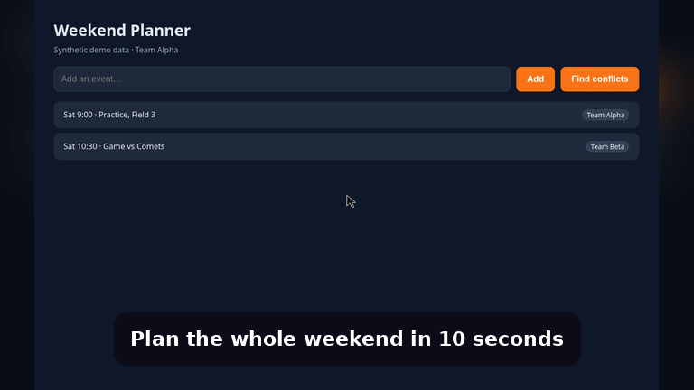

# Demo Director
Shot list in → polished demo GIF/MP4 out (16:9, 1:1, 9:16), recorded from a real browser. Synthetic data only.



```bash
pip install playwright pillow && playwright install chromium   # plus ffmpeg
python -m unittest discover -s tests
python -m demo_director examples/weekend-planner.json -o shots   # set "url" to fixtures/app.html file URI
```
See SPEC.md.
